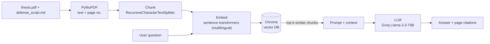

# 📈 Thesis Copilot — RAG Q&A over a Master's Thesis

Ask natural-language questions about my master's thesis and get answers **grounded in the thesis text, with page citations**. A compact, production-shaped Retrieval-Augmented Generation (RAG) pipeline.

> **Thesis Copilot** — a Retrieval-Augmented Generation assistant for Q&A over a research document (LangChain · Chroma · sentence-transformers · Groq LLM · Streamlit). Local multilingual embeddings (no cloud cost), semantic search over the thesis with source citations, and a graceful retrieval-only mode when no LLM key is set.

The thesis: *Forecasting Time-Varying Intermarket Dependencies Between Cryptocurrencies and Conventional Assets Using Machine Learning* — [thesis repo](https://github.com/b0gdaan/master-thesis) · [project site](https://b0gdaan.github.io/master-thesis/).

---

## What it does

- **Ingests** the thesis PDF (76 pages) plus the defense Q&A: extracts text page-by-page (keeping page numbers for citations), splits it into overlapping chunks, embeds them locally, and stores the vectors in a persistent Chroma database.
- **Retrieves** the most semantically relevant passages for any question — in **English, Serbian, or Russian** (multilingual embeddings, so the question and the thesis don't have to share a language).
- **Generates** a concise, grounded answer with an LLM and shows the pages it used. With **no API key**, it still returns the top passages — semantic search runs fully offline.

## Architecture



## Stack

| Layer | Choice | Why |
|---|---|---|
| PDF parsing | **PyMuPDF** | fast, keeps page numbers for citations |
| Chunking | LangChain `RecursiveCharacterTextSplitter` | structure-aware overlapping splits |
| Embeddings | `paraphrase-multilingual-MiniLM-L12-v2` | local, free, handles EN / SR / RU |
| Vector DB | **Chroma** (persistent) | zero-config local store |
| LLM | Groq `llama-3.3-70b-versatile` | free & fast; swappable for OpenAI / DeepSeek |
| UI | **Streamlit** + CLI | chat app plus a scriptable `ask.py` |

## Quickstart

```bash
# 1. Environment (Python 3.11)
py -3.11 -m venv .venv
.venv\Scripts\activate          # Windows
# source .venv/bin/activate     # macOS / Linux
pip install -r requirements.txt

# 2. Build the index (first run downloads the embedding model, ~1 min)
python ingest.py

# 3a. Ask from the command line
python ask.py "Which model had the best RMSE, and why?"

# 3b. ...or launch the chat UI
streamlit run app.py
```

### Enabling generated answers (optional, free)

Semantic search works offline out of the box. To get *written* answers, add a free Groq key:

```bash
cp .env.example .env
# then edit .env:  GROQ_API_KEY=gsk_...     (free at https://console.groq.com/keys)
```

Prefer OpenAI or DeepSeek? Set `LLM_PROVIDER=openai`, `OPENAI_API_KEY`, and `OPENAI_BASE_URL` in `.env`.

## Example

**Retrieval-only mode** (no API key) — `python ask.py "Which model had the best RMSE, and why?"`:

```
Below are the most relevant passages from the thesis (semantic search runs
fully offline). Set GROQ_API_KEY in .env to enable written answers.

- Sources -
  - thesis.pdf, p.29
  - thesis.pdf, p.30
```

The top hit (p.29) is exactly the model-ranking table — *"Best-performing model by average RMSE is Ridge."* With a Groq key in `.env`, the same question returns a written, cited answer instead of raw passages.

**Cross-lingual retrieval** — a Russian or Serbian question finds the right English passage:

| Question | Top source found |
|---|---|
| `Which model had the best RMSE?` | `thesis.pdf` p.29 — model-ranking table |
| `Why does DCC-GARCH perform worst?` | `defense_script.md` — *"Why is DCC-GARCH weaker here?"* |
| `Почему простые модели обошли сложные?` (RU) | `defense_script.md` — *"Why are simple models better than complex ones?"* |

See [`sample_questions.md`](sample_questions.md) for more prompts.

## Deploy a live demo

**Hugging Face Spaces** (free, recommended — comfortably fits the embedding model):

1. Create a Space at <https://huggingface.co/new-space> → SDK **Streamlit**, hardware **CPU basic (free)**, visibility **Public**.
2. Push this repo to the Space:
   ```bash
   huggingface-cli login                 # paste a token from hf.co/settings/tokens
   git remote add space https://huggingface.co/spaces/<your-hf-user>/thesis-copilot
   git push space main
   ```
3. The Space installs `requirements.txt`, starts `app.py`, and **builds the index automatically on first load** (~1–2 min). The `chroma_db/` index is intentionally not committed, so the same repo deploys cleanly anywhere.
4. *(optional)* For generated answers, add `GROQ_API_KEY` under the Space's **Settings → Variables and secrets**.

> GitHub Pages can't host the app itself (it serves static files only; Streamlit needs a Python server). The landing page under [`docs/`](docs/index.html) is published via GitHub Pages and links to the live Space.

## Project layout

```
genai/
├── data/                 # source documents (read-only copy of the thesis PDF + defense Q&A)
├── config.py             # all tunables (paths, models, chunking, provider)
├── embeddings.py         # shared local embedding model
├── ingest.py             # build the Chroma index from data/
├── rag.py                # retrieve + generate (core RAG logic)
├── ask.py                # command-line Q&A
├── app.py                # Streamlit chat UI
├── requirements.txt      # dependencies (pins in requirements.lock.txt)
└── chroma_db/            # generated vector store (git-ignored)
```

## How it works (in one paragraph)

`ingest.py` turns each PDF page into a `Document` with its page number, splits everything into ~1000-character overlapping chunks, embeds them with a local multilingual sentence-transformer, and writes the vectors to Chroma. At query time `rag.py` embeds the question with the *same* model, pulls the top-k nearest chunks, packs them into a grounded prompt, and asks the LLM to answer using only that context — returning the answer together with the source pages. If no LLM key is set, it returns the retrieved passages instead, so the retrieval half is always demonstrable.

## Notes

- The files under `data/` are a **read-only copy**; the original thesis project is untouched.
- `chroma_db/` and `.env` are git-ignored. Rebuild the index anytime with `python ingest.py --reset`.
- Built and tested on **Python 3.11** (Windows).
